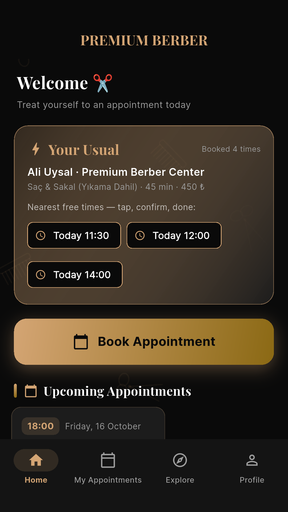
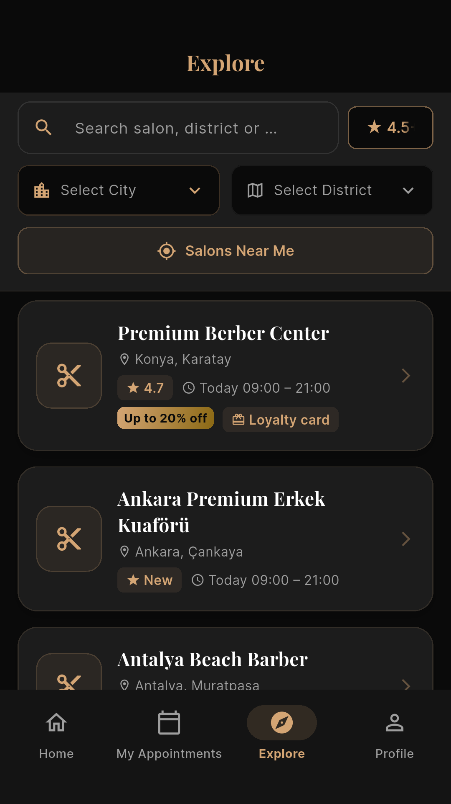
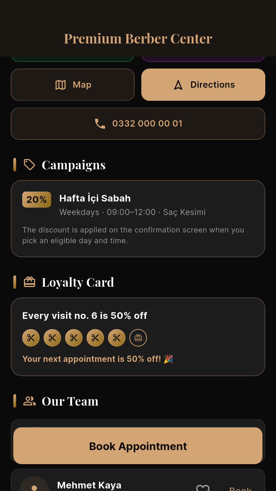
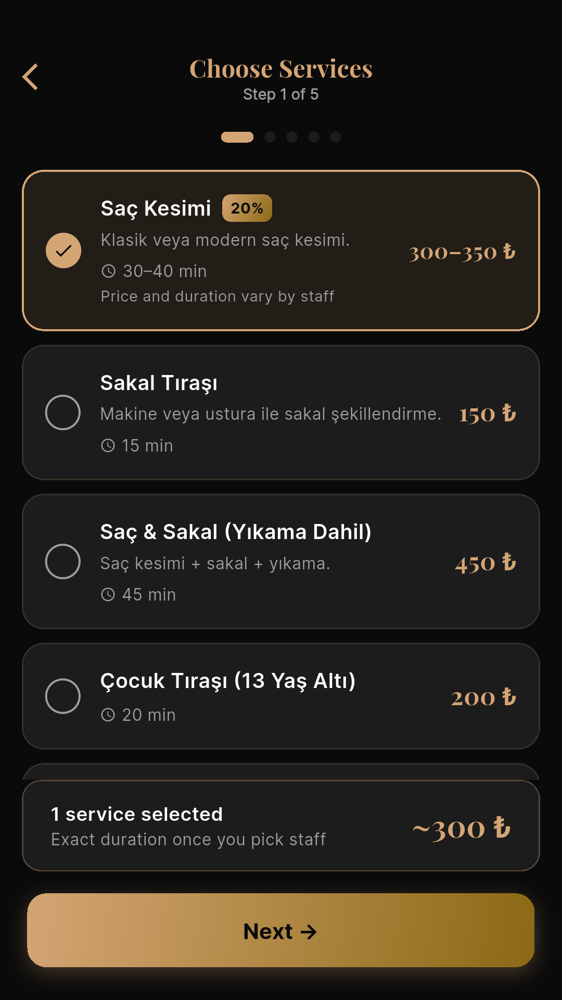
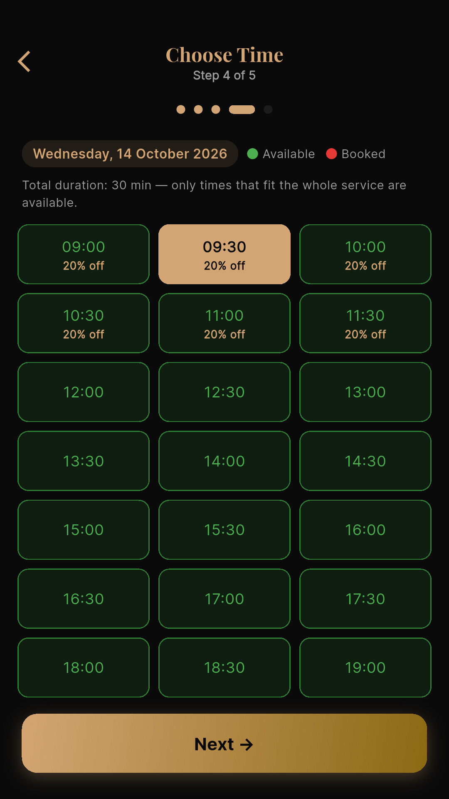
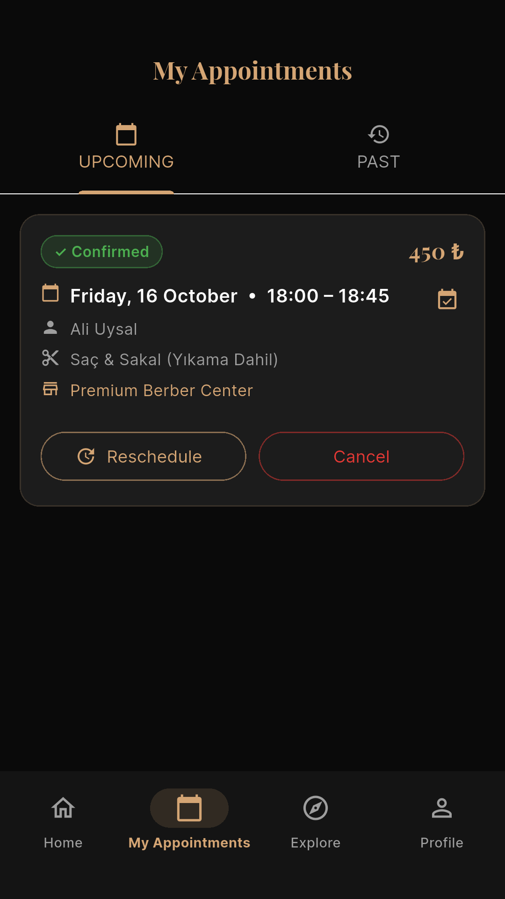
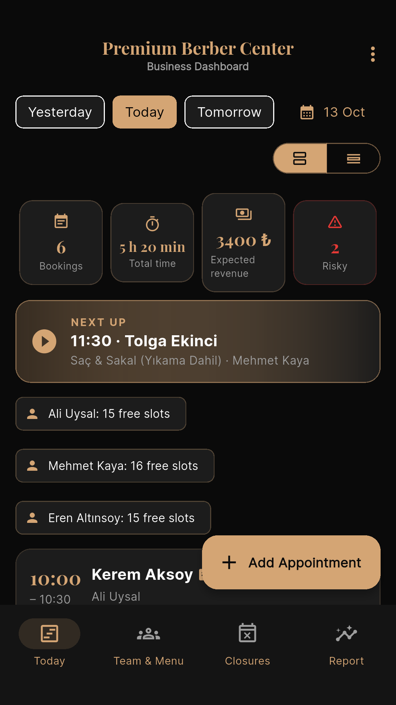
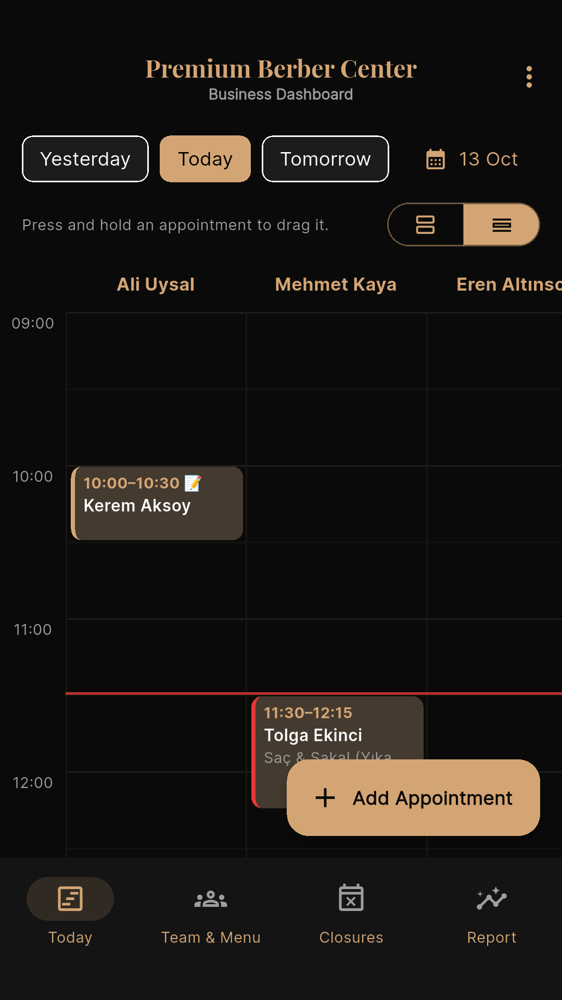
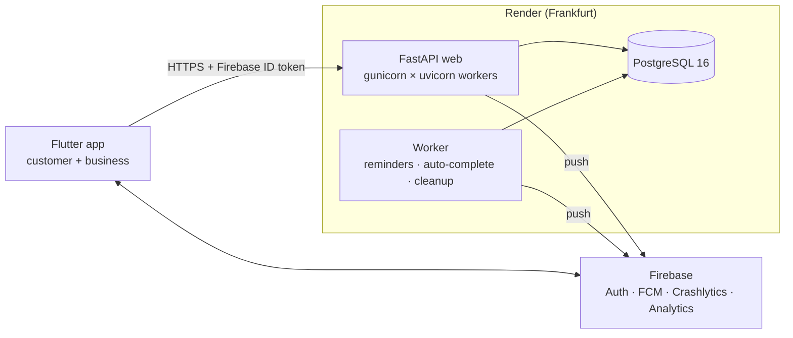

# Premium Berber

[](https://github.com/TevfikUner/Salon_Booking_App/actions/workflows/ci.yml)


**🇬🇧 English** · [🇹🇷 Türkçe](README.tr.md)

A barber and hair-salon booking platform: a Flutter app with two sides in one binary and a FastAPI backend.
Customers find a salon, pick a barber and services, and book a free slot in a few taps. Salon owners run their day
from the phone: today's flow, a drag-and-drop staff calendar, team and menu, campaigns, closures and reports.

Built to production standards: release-signed Android build, Render blueprint, load-tested to 1,000 concurrent
users, KVKK (Turkish GDPR) compliant account deletion and optional field-level encryption. Not published to a store.

<table>
  <tr>
    <th>Customer: "Your Usual" one-tap booking</th>
    <th>Business: drag an appointment to another barber</th>
  </tr>
  <tr>
    <td></td>
    <td></td>
  </tr>
</table>

## Features

**Customers**
- **Your Usual** card: their regular barber + services with the nearest free times, booked in two taps
- Explore salons by city, district or distance; search by salon, district or service; rating filter
- 5-step booking: services → staff (per-barber price and duration) → calendar (full and busy days marked) → time → confirm
- Reschedule (same barber, price locked, max 2), cancel up to 30 minutes before, waitlist when a day is full
- Campaign and loyalty-card discounts shown before confirming; best single discount wins
- Reviews with rating breakdown, favourites, "Book the same again", add to Google Calendar / `.ics`
- Contextual notification-permission prompt after the first booking; 1-hour reminder push

**Salon owners and staff**
- **Today's flow**: bookings, total time, expected revenue, no-show risk; next-up card; one-tap WhatsApp confirmation
- **Day calendar** with a column per barber: long-press and drag to move an appointment across time and staff
- Walk-in / phone bookings under the same rules; customer card with history, spend, trust score and private notes
- Team and menu: per-barber services, prices and durations, weekly days off, lunch break, hourly blocks
- Campaigns (day / time / date / service conditions) and a loyalty card (every Nth visit X% off)
- Closures, minimum notice for bookings, monthly report (revenue, average ticket, no-show rate, discounts given)
- Push notifications for new, cancelled and rescheduled bookings

**Platform**
- Roles derived from data: customer, business (admin-approved), staff (invited by email), admin
- Turkish and English UI (device language or chosen in Profile); server messages translated via `Accept-Language`
- Account deletion in the app and on the web (anonymisation), public privacy / KVKK / terms pages
- Admin CLI: approve businesses, add admins, process deletion requests, rotate the encryption key

## Screenshots

| Home | Explore | Salon | Services |
|---|---|---|---|
|  |  |  |  |
| **Time (campaign slots)** | **My appointments** | **Business: today** | **Business: day calendar** |
|  |  |  |  |

Service names come from the salon's own menu, so they stay in Turkish in the English UI.

## Architecture



- **The backend is the single source of truth for availability.** `slot_servisi.py` computes free times from
  opening hours, closures, staff days off, lunch breaks, hourly blocks, minimum notice and existing bookings. The
  app never computes slots itself.
- **Scheduled jobs run only in the worker process.** Each job takes a database lease lock, so running several
  copies is safe.
- **Authentication:** every request carries a Firebase ID token, verified with the Admin SDK. In local `dev` mode the
  backend also accepts `Bearer dev:<uid>`. Production refuses to start in that mode.

| Layer | Technology |
|---|---|
| Mobile | Flutter 3.47, Dart 3.11, gen-l10n (TR/EN), table_calendar, Firebase (Auth, Messaging, Crashlytics, Analytics) |
| API | FastAPI, SQLAlchemy 2, Alembic (9 migrations), Pydantic Settings, slowapi rate limits, APScheduler |
| Data | PostgreSQL 16 in production, SQLite for development and tests |
| Ops | Docker, gunicorn + uvicorn workers, Render blueprint, Sentry, JSON logs with request IDs |
| Quality | pytest (161), Flutter unit/widget (64) + emulator end-to-end tests, Locust load tests, ruff, GitHub Actions |

## Engineering highlights

- **No double bookings under concurrency.** Each booking takes a per-barber row lock (`SELECT … FOR UPDATE`) and
  re-checks availability inside the lock. A partial unique index (`uq_randevu_aktif_slot`) backs this up. In the race
  test, 100 simultaneous requests for the same slot returned one `200` and ninety-nine `409`s, each `409` with
  alternative times.
- **Idempotent writes.** Booking, rescheduling and walk-in creation accept an `Idempotency-Key` header, so a double tap
  or a network retry never creates two appointments.
- **Load tested** ([docs/load-testing.md](docs/load-testing.md)):
  - 200 concurrent users: p95 of 47 ms.
  - 1,000 concurrent users on 6 workers: 73,319 requests, read p95 ≤ 270 ms, booking p95 530 ms, 0.005% errors.
  - Zero double bookings after every run.
  - An N+1 query in the availability calendar was found and fixed (p50 from 52 to 9 ms).
- **Resilience.** During a database outage the API returns a clean `503`. In the restart test, all 1,225 bookings
  were kept. The health check covers the database.
- **Prices and durations are sealed when a booking is made.** Later menu changes never alter existing appointments.
  The same applies to discounts.
- **Privacy (KVKK):**
  - Optional Fernet field-level encryption for names, phone numbers, emails, notes and reviews.
  - Phone numbers are matched through an HMAC digest, so lookups work on encrypted data.
  - Key rotation is supported, and account deletion anonymises the user's records.
- **Release hardening.** The Android release build uses R8, strips unused permissions and accepts HTTPS only. The app
  refuses to start if built against an `http://` API. Rate limits, body-size limits and upload magic-byte checks are
  in place, and `/docs` is closed in production.
- **Decisions are documented.** Every non-trivial choice is recorded with the alternatives considered and the reasons:
  [docs/decisions.md](docs/decisions.md).

## Quick start

Try both sides of the app locally without a Firebase account: the backend runs in `dev` auth mode and the app's
**demo mode** signs in as the seeded customer or business owner.

### 1. Backend

**With Docker** (PostgreSQL + API + worker):

```bash
API_PORT=8010 docker compose -p premium-berber up -d --build
docker compose -p premium-berber exec api python seed_demo.py     # demo data (wipes all tables)
curl localhost:8010/health                                         # {"durum":"ok","veritabani":"ok",...}
```

**Or with Python 3.12+** (SQLite):

```bash
cd backend
python -m venv .venv
source .venv/bin/activate              # Windows: .venv\Scripts\activate
pip install -r requirements-dev.txt
cp .env.example .env                   # AUTH_MODE=dev
alembic upgrade head
python seed_demo.py
uvicorn main:app --reload --host 0.0.0.0 --port 8010
```

API docs: http://localhost:8010/docs. Without the app, use `Authorization: Bearer dev:demo-musteri` or
`dev:demo-isletme`.

### 2. App

Requirements: Flutter 3.47, JDK 17+ and an Android emulator.

```bash
cd App
flutter pub get
flutter run --dart-define=DEMO=true
```

Scroll down on the welcome screen and tap **Try as customer** or **Try as business**. The emulator reaches the
backend at `10.0.2.2:8010` by default. On a physical device, also pass
`--dart-define=API_URL=http://<your-computer-ip>:8010`.

Demo mode exists only in debug builds. Release builds and the production backend reject `dev:` tokens.

## Tests

```bash
cd backend && pytest && ruff check .                         # 161 tests
TEST_DATABASE_URL=postgresql://... pytest                    # same suite on PostgreSQL
VERI_ANAHTARI=any-key pytest                                 # same suite with field encryption on
cd App && flutter analyze && flutter test                    # unit + widget, incl. 360 dp / 1.3× text overflow checks
```

- CI runs the backend suite on SQLite, PostgreSQL 16 and with encryption on. It also runs the Flutter checks:
  generated localizations up to date, legal texts in sync, `analyze` and `test`.
- End-to-end tests drive the real app on an emulator against a real backend: `App/integration_test/`.

## Project structure

```
backend/
  main.py, routers/        FastAPI app and endpoints (customer, salon, booking, panel, admin, legal)
  slot_servisi.py          availability engine (single source of truth)
  randevu_servisi.py       booking, reschedule, cancellation with locking and sealed prices
  fiyat_servisi.py         campaigns and loyalty discounts
  veri_sifreleme.py        optional field-level encryption (Fernet + HMAC lookup)
  ceviri.py                English server messages via Accept-Language
  worker.py, gorevler.py   scheduled jobs (reminders, auto-complete) with DB lease lock
  alembic/                 migrations · tests/ pytest suite · yuk/ load and race tests (Locust)
App/lib/
  core/                    config, theme, formatting, i18n access, shared widgets
  data/                    API client (errors, retries, idempotency) and models
  features/                one folder per feature: login, customer, explore, booking flow, business panel, support
  services/                auth, push notifications, role-based routing, crash reporting, analytics
docs/                      decisions, deployment, load testing, demo script, audits (Turkish)
MAGAZA/                    Play Store listing texts, graphics, data-safety and content-rating answers
```

## Documentation

All in Turkish:

- [docs/decisions.md](docs/decisions.md): architecture and product decisions, with the alternatives considered.
- [docs/deployment.md](docs/deployment.md): Firebase and Render setup, Android release, monitoring, scaling and
  rollback.
- [docs/load-testing.md](docs/load-testing.md): load, race and outage tests, with results.
- [docs/demo-script.md](docs/demo-script.md): a 5-minute walkthrough.
- [docs/initial-audit.md](docs/initial-audit.md): audit of the original prototype and competitor analysis.
- [docs/inspiration-analysis.md](docs/inspiration-analysis.md): comparison with 26 open-source booking apps.

## Roadmap

These are deliberately out of scope because each needs a paid service or contract:

- **Online deposit / payment** against no-shows (iyzico or PayTR).
- **Salon gallery and photo reviews.** Needs object storage and moderation.
- **SMS / WhatsApp Business reminders.** Needs an SMS provider and İYS registration.

## License

Copyright © 2026 Tevfik Uner. All rights reserved. The source is published for portfolio review only; see
[LICENSE](LICENSE).
