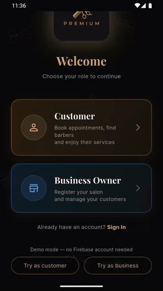
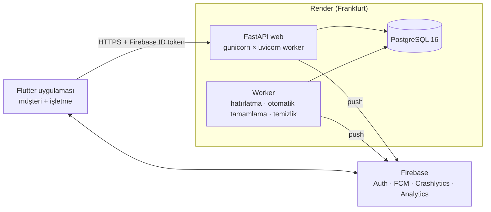

# Premium Berber

[](https://github.com/TevfikUner/Salon_Booking_App/actions/workflows/ci.yml)


[🇬🇧 English](README.md) · **🇹🇷 Türkçe**

Berber ve kuaför randevu platformu: müşteri ve işletme tarafı tek uygulamada olan bir Flutter uygulaması ve FastAPI
backend'i. Müşteri salon bulur, berber ve hizmet seçer, boş saati birkaç dokunuşla alır. İşletme sahibi günü
telefonundan yönetir: günün akışı, sürükle-bırak personel takvimi, ekip ve menü, kampanyalar, kapalı günler ve raporlar.

Yayına hazır standartta geliştirildi:

- Release imzalı Android derlemesi ve Render blueprint'i hazır.
- 1.000 eşzamanlı kullanıcıyla yük testi yapıldı.
- KVKK'ya uygun hesap silme ve isteğe bağlı alan düzeyinde şifreleme var.

Mağazada yayınlanmadı.

<table>
  <tr>
    <th>Müşteri: "Her Zamanki" ile tek dokunuşta randevu</th>
    <th>İşletme: randevuyu başka berbere sürükleme</th>
  </tr>
  <tr>
    <td></td>
    <td></td>
  </tr>
</table>

Görseller İngilizce arayüzden. Türkçe ekran görüntüleri: [MAGAZA/ekran_goruntuleri/](MAGAZA/ekran_goruntuleri/).

## Özellikler

**Müşteri**
- **Her Zamanki** kartı: alışılmış berber ve hizmetler, en yakın boş saatlerle; iki dokunuşta randevu
- İl, ilçe veya konuma göre salon keşfi; salon, ilçe veya hizmet adıyla arama; puan filtresi
- 5 adımlı randevu: hizmet → personel (berbere özel fiyat ve süre) → takvim (dolu ve az yer kalan günler işaretli) → saat → onay
- Erteleme (aynı berber, fiyat mühürlü, en fazla 2 kez), son 30 dakikaya kadar iptal, dolu günde bekleme listesi
- Kampanya ve sadakat kartı indirimi onaydan önce görünür; indirimler üst üste binmez, en iyisi uygulanır
- Puan dağılımıyla yorumlar, favoriler, "Aynısını Tekrar Al", Google Takvim / `.ics`
- İlk randevudan sonra bağlamlı bildirim izni; 1 saat kala hatırlatma

**İşletme ve personel**
- **Günün akışı:** randevu sayısı, toplam süre, beklenen ciro, gelmeme riski; sıradaki kartı; tek dokunuşla WhatsApp teyidi
- Personel sütunlu **gün takvimi:** randevuya basılı tutup başka saate veya berbere sürükleme
- Aynı kurallarla telefon / kapıdan gelen randevu; müşteri kartı (geçmiş, harcama, güven skoru, işletme notu)
- Ekip ve menü: berbere özel hizmet, fiyat ve süre, haftalık izin günleri, öğle arası, saatlik kapatma
- Kampanyalar (gün / saat / tarih / hizmet koşullu) ve sadakat kartı (her N. ziyarette %X)
- Kapalı günler, en az önceden randevu süresi, aylık rapor (ciro, ortalama sepet, gelmeme oranı, verilen indirim)
- Yeni, iptal edilen ve ertelenen randevuda push bildirimi

**Platform**
- Veriden türetilen roller: müşteri, işletme (admin onaylı), personel (e-postayla davet), admin
- Türkçe ve İngilizce arayüz (cihaz dili veya Profil'den seçim); sunucu mesajları `Accept-Language` ile çevrilir
- Uygulama içinden ve web'den hesap silme (anonimleştirme), herkese açık gizlilik / KVKK / kullanım koşulları sayfaları
- Yönetim komutları: işletme onayı, admin ekleme, silme talepleri, şifreleme anahtarı değişimi

## Mimari



- **Müsaitliğin tek doğruluk kaynağı backend.** `slot_servisi.py` boş saatleri hesaplarken şunları hesaba katar:
  çalışma saatleri, kapalı günler, personel izinleri, öğle arası, saatlik kapatma, en az önceden süresi ve mevcut
  randevular. Uygulama slot hesaplamaz.
- **Zamanlanmış görevler yalnızca worker sürecinde çalışır.** Her görev veritabanı kira kilidi alır; birden çok kopya
  güvenlidir.
- **Kimlik doğrulama:** her istek, Admin SDK ile doğrulanan bir Firebase ID token taşır.
  - Yerel `dev` modunda `Bearer dev:<uid>` da kabul edilir.
  - Production bu modda başlamayı reddeder.

| Katman | Teknoloji |
|---|---|
| Mobil | Flutter 3.47, Dart 3.11, gen-l10n (TR/EN), table_calendar, Firebase (Auth, Messaging, Crashlytics, Analytics) |
| API | FastAPI, SQLAlchemy 2, Alembic (9 migration), Pydantic Settings, slowapi hız sınırı, APScheduler |
| Veri | Production'da PostgreSQL 16, geliştirme ve testte SQLite |
| Operasyon | Docker, gunicorn + uvicorn worker, Render blueprint, Sentry, istek kimlikli JSON loglar |
| Kalite | pytest (161), Flutter birim/widget (64) + emülatörde uçtan uca testler, Locust yük testleri, ruff, GitHub Actions |

## Mühendislik notları

- **Eşzamanlı isteklerde çift randevu yok.** Her randevu berber satırında kilit alır (`SELECT … FOR UPDATE`) ve
  müsaitliği kilit içinde yeniden hesaplar. Arkada ayrıca kısmi tekil indeks (`uq_randevu_aktif_slot`) var. Yarış
  testinde aynı saate gelen 100 eşzamanlı istekten biri `200`, doksan dokuzu alternatif saatlerle `409` aldı.
- **Tekrar güvenli yazma.** Randevu, erteleme ve panelden randevu ekleme `Idempotency-Key` başlığını kabul eder.
  Çift dokunma veya ağ tekrarı iki randevu oluşturmaz.
- **Yük testi** ([docs/load-testing.md](docs/load-testing.md)):
  - 200 eşzamanlı kullanıcıda p95 47 ms.
  - 6 worker ile 1.000 eşzamanlı kullanıcıda 73.319 istek; okuma p95 ≤ 270 ms, randevu p95 530 ms, hata %0,005.
  - Her koşudan sonra çakışan randevu sayısı sıfır.
  - Takvimdeki N+1 sorgusu bulunup giderildi (p50 52 → 9 ms).
- **Dayanıklılık.** Veritabanı kesintisinde API düzgün bir `503` döner. Yeniden başlatma testinde 1.225 randevunun
  hepsi korundu. Sağlık kontrolü veritabanını da kapsar.
- **Fiyat ve süre randevu anında mühürlenir.** Menü değişikliği mevcut randevuları etkilemez; indirim için de aynısı
  geçerli.
- **Gizlilik (KVKK):**
  - Ad, telefon, e-posta, notlar ve yorumlar için isteğe bağlı Fernet şifreleme.
  - Telefon eşleştirmesi HMAC özetiyle yapılır, böylece şifreli veride arama çalışır.
  - Anahtar değişimi desteklenir; hesap silme kişinin kayıtlarını anonimleştirir.
- **Release sağlamlaştırma.** Android release derlemesinde R8 açık, gereksiz izinler kaldırıldı ve yalnızca HTTPS
  kabul edilir. Uygulama `http://` API adresiyle derlenmişse açılmaz. Hız sınırı, gövde boyutu sınırı ve dosya
  türü (sihirli bayt) kontrolü var; production'da `/docs` kapalı.
- **Kararlar belgeli.** Her önemli tercih, değerlendirilen alternatifler ve gerekçeleriyle
  [docs/decisions.md](docs/decisions.md)'de.

## Hızlı başlangıç

Firebase hesabı olmadan iki tarafı da yerelde deneyebilirsiniz: backend `dev` kimlik modunda çalışır, uygulamanın
**demo modu** seed'deki müşteri veya işletme sahibi olarak giriş yapar.

### 1. Backend

**Docker ile** (PostgreSQL + API + worker):

```bash
API_PORT=8010 docker compose -p premium-berber up -d --build
docker compose -p premium-berber exec api python seed_demo.py     # demo verisi (TÜM tabloları temizler)
curl localhost:8010/health                                         # {"durum":"ok","veritabani":"ok",...}
```

**Ya da Python 3.12+ ile** (SQLite):

```bash
cd backend
python -m venv .venv
source .venv/bin/activate              # Windows: .venv\Scripts\activate
pip install -r requirements-dev.txt
cp .env.example .env                   # AUTH_MODE=dev
alembic upgrade head
python seed_demo.py
uvicorn main:app --reload --host 0.0.0.0 --port 8010
python worker.py                       # (ayrı terminal, isteğe bağlı) hatırlatma/otomatik tamamlama
```

- API belgesi: http://localhost:8010/docs (production'da kapalı).
- Uygulamasız denemek için: `Authorization: Bearer dev:demo-musteri` veya `dev:demo-isletme`.
- Yönetim komutları: `python araclar.py --help`.

### 2. Uygulama

Gereksinim: Flutter 3.47, JDK 17+ ve Android emülatörü.

```bash
cd App
flutter pub get
flutter run --dart-define=DEMO=true
```

Hoş geldiniz ekranında aşağı kaydırıp **Müşteri olarak dene** veya **İşletme olarak dene**'ye dokunun.

- Emülatör backend'e varsayılan olarak `10.0.2.2:8010` adresinden ulaşır.
- Gerçek telefonda ayrıca `--dart-define=API_URL=http://<bilgisayar-ip>:8010` verin.
- Demo modu yalnızca debug derlemede vardır. Release derleme ve production backend `dev:` jetonunu reddeder.

Gerçek Firebase girişiyle çalıştırmak ve release derlemek için: [docs/deployment.md](docs/deployment.md).

## Testler

```bash
cd backend && pytest && ruff check .                         # 161 test
TEST_DATABASE_URL=postgresql://... pytest                    # aynı testler PostgreSQL'de
VERI_ANAHTARI=herhangi-bir-anahtar pytest                    # aynı testler şifreleme açıkken
cd App && flutter analyze && flutter test                    # birim + widget, 360 dp / 1,3× yazı taşma testleri dahil
```

- **CI** backend testlerini SQLite, PostgreSQL 16 ve şifreleme açıkken koşar.
- Flutter tarafında CI şunları kontrol eder: üretilen çeviri dosyalarının güncelliği, yasal metin senkronu,
  `analyze` ve `test`.
- **Uçtan uca testler** gerçek uygulamayı emülatörde gerçek backend'e karşı sürer (`App/integration_test/`):
  ```bash
  bash backend/yuk/yigin.sh entegrasyon
  flutter test integration_test/musteri_akisi_test.dart --dart-define=API_URL=http://10.0.2.2:8020
  ```
  Aynı şekilde `isletme_akisi_test.dart` ve `yeni_ozellikler_test.dart`.
- **Ekran görüntüleri:**
  ```bash
  flutter drive --driver=test_driver/ekran_goruntusu.dart --target=integration_test/ekran_goruntusu_test.dart
  ```
  İngilizce için `EKRAN_KLASORU=../docs/screenshots` ve `--dart-define=TEST_DIL=en` ekleyin.
- **Windows notu:** Smart App Control `flutter_tester`'ı engelliyorsa aynı birim testleri emülatörde koşulabilir:
  `flutter test integration_test/birim_cihazda_test.dart -d emulator-5554`.

## Kod yapısı

```
backend/
  main.py, routers/        FastAPI uygulaması ve uçlar (müşteri, salon, randevu, panel, admin, yasal)
  slot_servisi.py          müsaitlik hesabı (tek doğruluk kaynağı)
  randevu_servisi.py       kilitli ve fiyatı mühürlü randevu, erteleme, iptal
  fiyat_servisi.py         kampanya ve sadakat indirimi
  veri_sifreleme.py        isteğe bağlı alan şifreleme (Fernet + HMAC arama)
  ceviri.py                Accept-Language ile İngilizce sunucu mesajları
  worker.py, gorevler.py   DB kilitli zamanlanmış görevler (hatırlatma, otomatik tamamlama)
  alembic/                 migration'lar · tests/ pytest · yuk/ yük ve yarış testleri (Locust)
App/lib/
  core/                    config, tema, biçimlendirme, dil erişimi, ortak bileşenler
  data/                    API istemcisi (hata, yeniden deneme, idempotency) ve modeller
  features/                her özellik kendi klasöründe: giriş, müşteri, keşfet, randevu akışı, işletme paneli, destek
  services/                kimlik, push bildirimleri, rol bazlı yönlendirme, hata raporlama, analitik
docs/                      kararlar, dağıtım, yük testi, demo senaryosu, analizler
MAGAZA/                    Play Store metinleri, görseller, veri güvenliği ve içerik derecelendirme yanıtları
```

Kurallar:

- Ekran dosyası durumu ve düzeni taşır; görsel parçalar `widgets/` altına konur. Dosya başına en fazla 250 satır.
- Metinler `lib/l10n/app_tr.arb` (şablon) ve `app_en.arb` dosyalarında. Değiştirdikten sonra `flutter gen-l10n`
  çalıştırılır; kodda `Dil.t.anahtar` ile erişilir.
- Yasal metinler `backend/yasal/*.md`'den üretilir: `python scripts/yasal_senkron.py`. Üretilen dosyalar elle
  düzenlenmez.
- Model değişince migration şöyle eklenir: `alembic revision --autogenerate -m "aciklama"` → oluşan dosyayı gözden
  geçirin → `alembic upgrade head`.

## Önemli uçlar

| Uç | Açıklama |
|---|---|
| `GET /health` | Sağlık (DB dahil; DB yoksa 503) |
| `GET /ben` | Oturumdaki kullanıcının rolü ve bağlamı |
| `GET /salonlar?sehir=&ilce=&lat=&lng=&q=&min_puan=`, `/salonlar/{id}` | Keşfet (harf duyarsız filtre ve arama — salon/ilçe/hizmet adı, konuma göre sıralama, favori işareti, berber tıraş/yorum sayısı) |
| `GET /hizmetler/?salon_id=&berber_id=` | Salonun menüsü (personel arası fiyat/süre aralığı, kampanya yüzdesi); berberle: yalnızca onun verdikleri, onun fiyatıyla |
| `GET /berberler/?salon_id=&hizmet_ids=` | Personel; hizmet verilirse her birinde `uygun`, vermedikleri ve o berberdeki toplam fiyat/süre |
| `GET /randevular/fiyat?berber_id=&tarih=&saat=&hizmet_ids=` | Onay öncesi tutar: liste fiyatı, kampanya veya sadakat indirimi, toplam |
| `GET /randevular/{id}/tekrar-onerisi?hafta=` | "N hafta sonra aynı saatte" önerisi (varsayılan: müşterinin olağan aralığı) |
| `GET /randevular/musait-takvim?berber_id=&hizmet_ids=` | Açık günler (tatil/izin/kapalı gün/berberin haftalık izni hariç); hizmet verilirse gün başına boş saat sayısı ve `dolu` |
| `GET /degerlendirmeler/salon/{id}?sayfa=` | Salon yorumları: ortalama, 1–5 dağılımı, sayfalı liste |
| `GET /randevular/musait-saatler/{berber_id}?tarih=&hizmet_ids=` | Tek doğruluk kaynağı: müsait saatler |
| `POST /randevular/olustur` | Randevu (çakışmada 409 + öneriler; `Idempotency-Key` başlığı ile tekrar güvenli) |
| `POST /randevular/{id}/iptal` | Müşteri iptali (son 30 dk hariç); işletmeye ve berbere push |
| `POST /randevular/{id}/ertele` | Müşteri ertelemesi: aynı berber, süre/fiyat mühürlü, en fazla 2 kez, son 30 dk hariç (`Idempotency-Key`) |
| `GET /randevular/{id}/takvim.ics` | Randevunun iCalendar dosyası (yalnızca sahibine) |
| `GET /randevular/her-zamanki` | ⭐ "Her Zamanki" + en yakın boş slotlar |
| `POST /randevular/bekleme-listesi` | Yer açılırsa haber ver |
| `GET /panel/akis?tarih=` | ⭐ Bugünün Akışı (özet, güven skoru, WhatsApp linki) |
| `PATCH /panel/randevular/{id}/durum` | tamamlandi / gelmedi / iptal |
| `POST /panel/randevular` | Telefonla/kapıdan gelen müşteri |
| `GET /panel/musteriler/{id}`, `PUT /panel/musteriler/{id}/not` | Müşteri kartı (bu salondaki geçmiş, harcama, güven skoru) ve kalıcı işletme notu |
| `POST /panel/bloke`, `DELETE /panel/bloke/{id}` | Berberi bir günün belirli saatlerinde kapatma |
| `POST /panel/randevular/{id}/tasi` | Gün takviminde sürükle-bırak: başka saat/gün/personel (fiyat ve süre aynı, müşteriye bildirim) |
| `GET/PUT /panel/personel/{id}/hizmetler` | Personelin verdiği hizmetler ve kendine özel fiyat/süre |
| `/panel/kampanyalar`, `PUT /panel/sadakat` | Kampanyalar (gün/saat/tarih/hizmet koşullu yüzde) ve sadakat kartı (her N. ziyaret %X) |
| `/panel/personel`, `/panel/hizmetler`, `/panel/tatil`, `/panel/izin`, `/panel/rapor`, `/panel/salon` | İşletme yönetimi (personelin haftalık izin günleri, salonun öğle arası ve "en az önceden" süresi dahil) |
| `POST /isletmeler/kayit`, `POST /isletmeler/{id}/onayla` | İşletme başvurusu ve admin onayı |
| `DELETE /musteriler/hesabim` | Hesap silme (müşteri, işletme, personel — anonimleştirme) |
| `GET /yasal/{gizlilik,kvkk,kullanim}` | Herkese açık yasal sayfalar |
| `GET/POST /yasal/hesap-silme` | Web'den hesap silme talebi (oturumsuz) |

## Belgeler

- [docs/decisions.md](docs/decisions.md): mimari ve ürün kararları, değerlendirilen alternatiflerle.
- [docs/deployment.md](docs/deployment.md): Firebase ve Render kurulumu, Android sürümü, izleme, ölçekleme, geri alma.
- [docs/load-testing.md](docs/load-testing.md): yük, yarış ve kesinti testleri ile sonuçları.
- [docs/demo-script.md](docs/demo-script.md): 5 dakikalık demo senaryosu.
- [docs/initial-audit.md](docs/initial-audit.md): ilk prototipin analizi ve rakip analizi.
- [docs/inspiration-analysis.md](docs/inspiration-analysis.md): 26 açık kaynak randevu uygulamasıyla karşılaştırma.

## Yol haritası

Ücretli bir servis ya da sözleşme gerektirdikleri için bilinçli olarak kapsam dışında bırakıldılar:

- **Online kapora / ödeme:** gelmeyen müşteriye karşı (iyzico veya PayTR).
- **Salon galerisi ve fotoğraflı yorum:** obje depolama ve moderasyon gerektirir.
- **SMS / WhatsApp Business hatırlatması:** SMS sağlayıcısı ve İYS kaydı gerektirir.

## Lisans

Telif hakkı © 2026 Tevfik Uner. Tüm hakları saklıdır. Kaynak kod yalnızca portfolyo incelemesi için yayımlanmıştır;
bkz. [LICENSE](LICENSE).
